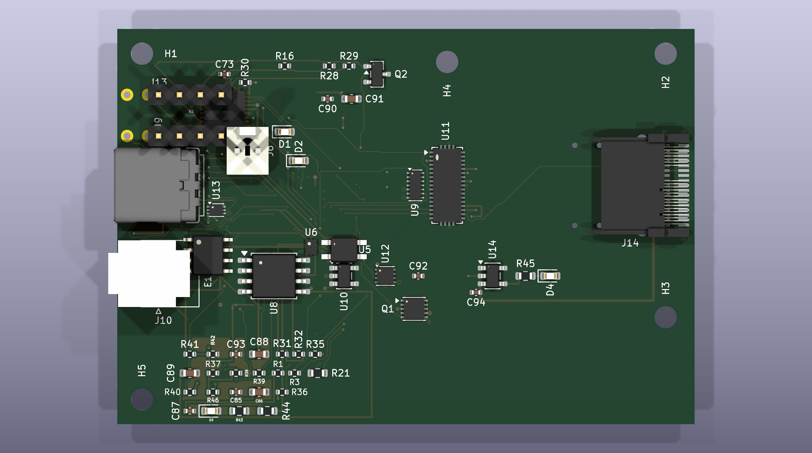

# hw_ic_k1 — K1 Master Gate Card (PCIe 2.1 x2 Injection)


*K1 R2.3 tapeout candidate — 3D top-flat render (4K). U1 (STM32G0B1KBU6N)
pad parity with the schematic restored: 5 pads fixed, so the authentication
latch clock, key-detect sense and USB D-N are no longer grounded or swapped;
DRC: 0 new hard errors, 3 pre-existing J1 (Type-C) baseline waivers,
0 unrouted nets. Renders carry full provenance (mounted copies proven
electrically identical to the fab board).*

Open-source hardware — KiCad design files for the **K1 Master Gate Card**,
the master-side converter card in the IOCONVERT V2.0 1-Master-to-4-Worker
chained NTB cluster.

## Overview

K1 sits at the **master side** of a PCIe NTB chain. It provides USB Type-C
management access, pre-authentication gating (SE050 via I2C), and a PCIe
2.1 x2 data path injected into the master host through an OCuLink connector.

```
KEY (secure vault) ──Type-C──► K1 Master Gate Card ──SlimSAS──► Master Host
                                  │
                                  ├─ USB management (SBU I2C ↔ SE050 pre-auth)
                                  ├─ PCIe 2.1 x2 lane injection
                                  └─ 5V pre-auth power rail (TLV61046 boost)
```

## Key Features

- **Form factor**: 70 × 48 mm, 4-layer PCB (#K1-REV-17 缩板)
- **Interface**: USB Type-C (KEY), SlimSAS SFF-8654 4i (host, #W4 换件), 12V DC-in
- **Security**: STM32G0B1 MCU gatekeeper + SE050 pre-authentication via SBU I2C
- **Data path**: PCIe 2.1 x2 with PI3DBS16412 lane-swap MUX
- **Power**: 3.3V_AUX → 5V boost (TLV61046), LDO 5V→3V3, 12V→3V3 DC-DC
- **Management**: OOB UART passthrough, opto-isolated power button (LTV-356T)

## Repository Contents

| Path | Description |
|---|---|
| `k1_v1.kicad_pro` / `.kicad_pcb` | KiCad 10 project + PCB (self-contained) |
| `sch/` | Schematics: connectors, MCU & sideband, power (12V/5V/3V3), decoupling |
| `lib/IOCONVERT.kicad_sym` | Symbol library (80 symbols) — required for schematics |
| `lib/ForgeOS.pretty/` | Footprint library (19 footprints) |
| `boards/` | Board/nets configuration (YAML) |

## Getting Started

1. Install [KiCad](https://www.kicad.org/) 10.x
2. Clone this repository
3. Open `k1_v1.kicad_pro` (latest tracked generation; the current R2.3
   tapeout candidate ships in `fab/` of the working tree, pending archive)
4. If symbols/footprints show as missing, add `lib/IOCONVERT.kicad_sym`
   to the symbol library table and `lib/ForgeOS.pretty/` to the footprint
   library table (global or project-level)

## Status — 2026-11-22

Tapeout chain: **v1 → R2 → R2.1 → R2.2 → R2.3** (current candidate,
2026-11-22).

- R2.3 board sha256 `553c63bf8573dcd1…`: U1 five-pad schematic-parity ECO
  (pads 2/3/16/23/29 → POWER_LOST_N / AUTH_OK_PULSE / KEY_DET_SENSE /
  MCU_USB_D_N / KEY_PRESENT), restoring the authentication latch clock,
  key-detect sense and USB D-N that were previously grounded or swapped.
  True electrical change: electrical sha `6619987cc47ae7b7…`, track
  segments `0325e382…`, nets 60 → 64 (five nets leave GND and reconnect
  for real); DRC 0 new hard errors, 0 unrouted nets; silkscreen held
  60/60; renders carry full provenance.
- R2.2 board sha256 `a8526b57989c6a89…` (electrical zero-drift vs R2.1,
  geometry sha byte-identical; silkscreen designators re-placed and Value
  fields fixed from truth source); R2.1 sha `74920945c1583fa7…`; DRC at candidate gate: 51 violations =
  0 new hard errors + 3 pre-existing J1 baseline waivers (all soft) + 48 warnings,
  0 unrouted nets; H5 M2.5 NPTH mounting hole added; four connector-family
  orientations solved.
- Fabrication-candidate deliverables live in the working tree (`fab/` renders,
  gerber exports) and are intentionally not tracked here yet.
- Toolchain migration to the Rust `rcore` engine is underway: milestones
  **M1** (routing: raster/astar/planner/plan_io + model orientation, exact-parity
  vs Python incl. pixel-level Pillow Draw.c reimplementation) and **M2**
  (exam/QA engine, 14-subject exam suite, 479 tests green) are landed;
  **M3** (schematic generation + board tooling) landed.

## License

AGPL-3.0 (see `LICENSE`)

---

*Part of the IOCONVERT V2.0 family: [hw_ic_k2](https://github.com/dataxcash/hw_ic_k2) (worker data-plane card) · [hw_ic_key](https://github.com/dataxcash/hw_ic_key) (secure key vault)*
